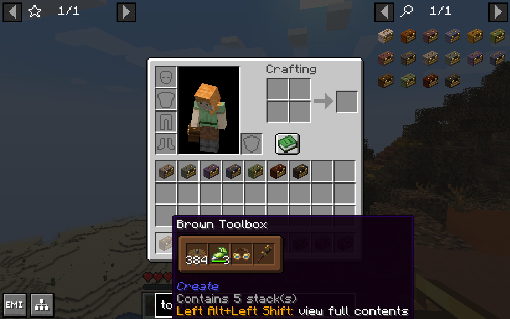
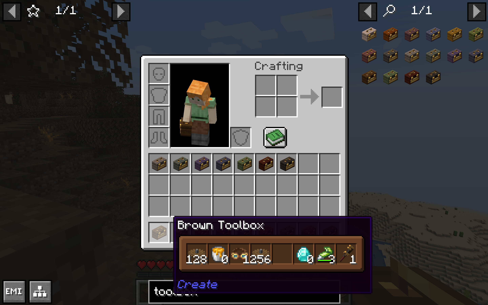

# Create Toolbox Tooltip

&nbsp;&nbsp;&nbsp;

This addon mod shows a tooltip which displays the contents of Create toolboxes when hovering over them in your inventory or in Create&rsquo;s radial toolbox menu.

 

  

This mod was made using the Shulker Box Tooltip API. You can edit its configurations under the Shulker Box Tooltip mod&rsquo;s config in Mod Menu (on Quilt/Fabric, you will need to have Mod Menu installed first). Check out their [Wiki](https://github.com/MisterPeModder/ShulkerBoxTooltip/wiki) and [Modrinth](https://modrinth.com/mod/shulkerboxtooltip) page for more info.

Big thanks to the creators of Shulker Box Tooltip for making this mod a possibility!

## Features:

View tooltips on the radial toolbox menu.

 

Displays empty item stacks.

 

(Basically) everything that Shulker Box Tooltip gives you for Shulker Boxes except for toolboxes including GUI color customization.

 

Ability to toggle on/off tooltips and change preview display modes for the radial toolbox menu.

Ability to toggle off tooltips for other container types besides toolboxes to prevent incompatibilities with other mods such as [Easy Shulker Boxes](https://modrinth.com/mod/easy-shulker-boxes).

 

Ability to toggle on/off Create&rsquo;s default tooltip for toolboxes.

### Coming Soon:

- Support for radial toolbox menu tooltips in Minecraft v1.20.1.

## Dependencies:

- [Create](https://modrinth.com/mod/create/versions?g=1.21.1&g=1.20.1) (and all its dependencies)
- Shulker Box Tooltip [v4.0.4+1.20.1](https://modrinth.com/mod/shulkerboxtooltip/versions?g=1.20.1) or [v5.1.9+1.21.1](https://modrinth.com/mod/shulkerboxtooltip/versions?g=1.21.1) (and all its dependencies)

### Recommended:

- [Mod Menu](https://modrinth.com/mod/modmenu) (On Quilt/Fabric)

## Support This Project

Did this mod help save you countless hours of digging through unlabelled toolboxes? Consider supporting its development! Donate to me on [PayPal](https://www.paypal.me/yisylvie), sponsor me on [GitHub](https://github.com/sponsors/yisylvie), or use my [referal link](https://billing.lilypad.gg/aff.php?aff=191) to start your own Lilypad server 🥰🤗

#### License

Copyright © 2026, Sylvie Lee. Licensed under the [MIT License](LICENSE).
